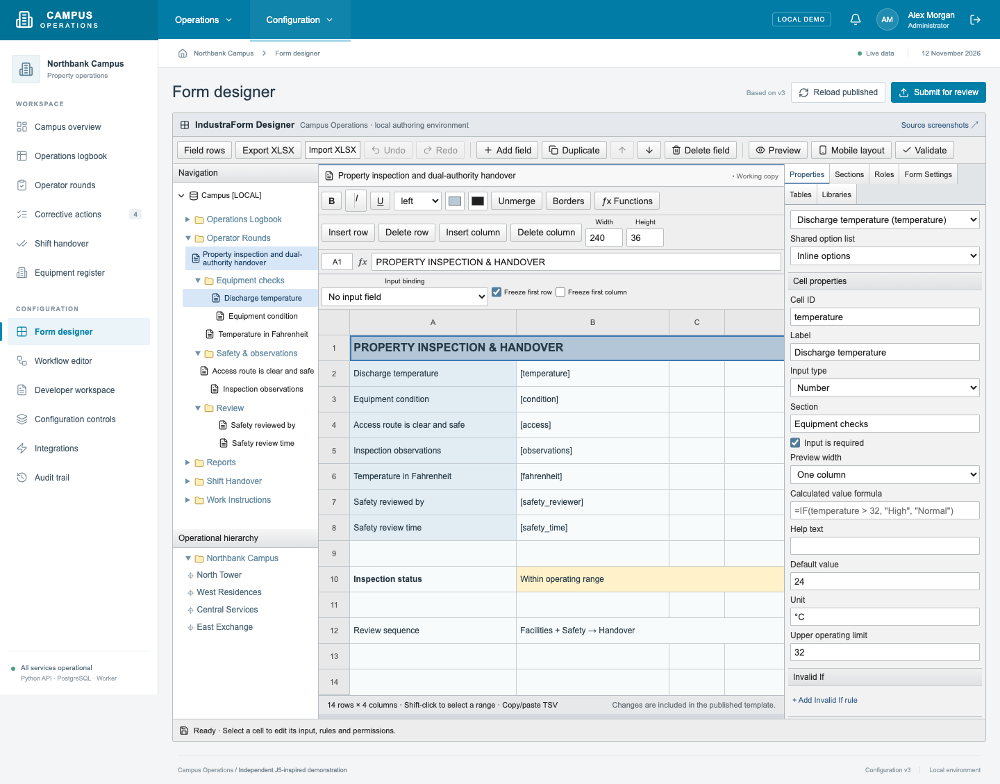

# Hexagon J5 Local Demo

A self-contained operations-management demo inspired by documented Hexagon J5 / Octave concepts. Design inspection forms, configure workflows, record operational events and hand work between facilities teams across a campus of apartments and commercial offices.

The React client, Python API, PostgreSQL database, background worker and Python execution service run together in Docker. Sample buildings, equipment and operational records are seeded automatically on first startup. No J5 installation, API key or external service is needed to run the demo.

**This is an independent implementation, not an official Hexagon/Octave product or a licensed J5 runtime.** Native IndustraForm packages and proprietary SDKs are not supported. API behaviour follows selected public contracts; native interoperability and pixel-perfect visual parity have not been verified. See [compatibility scope](docs/REFERENCE-SCOPE.md) and the [API contract matrix](docs/API-CONTRACT.md).



## Quick start

Install Git and Docker Desktop, or Docker Engine with the Compose plugin. Docker must be running; you do not need Python, Node.js or PostgreSQL installed on your host.

```bash
git clone https://github.com/davidgeorgewilliams/hexagon-j5-local-demo.git
cd hexagon-j5-local-demo
docker compose up --build -d --wait
```

Open **[http://localhost:8088](http://localhost:8088)**. The first build requires internet access to download images and dependencies. After the images are built, the demo runs locally without external services. The published port is bound to `127.0.0.1`.

Select a demo account and enter **`campus-demo`** as the password:

| Account | Username | Capabilities |
|---|---|---|
| Maya Chen | `maya` | Inspections, evidence, operational entries and corrective work |
| James Wilson | `james` | Supervisor reviews, approvals, handovers and sensor events |
| Alex Morgan | `alex` | Form/workflow authoring, reviewed releases, developer tools and access grants |

Start with **Alex Morgan** to explore the editors. Use the sign-out button to switch roles. These are shared demonstration identities; this deployment is intended for trusted local use, not public hosting.

## What you can explore

| Interface | Features |
|---|---|
| [Form designer](http://localhost:8088/#designer) | 500 × 52 spreadsheet layout, field bindings, merged cells, formatting, 53 formula functions, validation, repeating tables, inherited option lists/themes, XLSX import/export and preview |
| [Workflow editor](http://localhost:8088/#workflow) | Atomic, compound, parallel and final states; roles and conditions; entry/exit assignments; completion events; durable timers; shallow/deep history; simulation |
| [Operations logbook](http://localhost:8088/#logbook) | Rich-text entries, attachments, notes/flags, SQL filtering and pagination, timeline/calendar views, CSV export and audit history |
| [Operator rounds](http://localhost:8088/#rounds) | Equipment inspections, evidence, exception handling, corrective actions and version-pinned form definitions |
| [Developer workspace](http://localhost:8088/#workspace) | Editable project files, validation, ZIP packages, Python execution and line tracing, API explorer and building access grants |
| [Configuration controls](http://localhost:8088/#config) | Mandatory independent review, immutable published versions, conflict checks and building-specific templates |
| [Integrations](http://localhost:8088/#integrations) | Simulated sensor events, background processing, maintenance delivery retries and idempotency |
| [Shift handover](http://localhost:8088/#handovers) | Fixed snapshots of outstanding work, team briefings and acknowledgement |

### Try the property-handover example

1. Sign in as **Alex**, open **Developer workspace**, then select **Load property handover example**. This creates a working draft without changing the published configuration.
2. Choose **Validate project**, **Save project**, then **Load into designer**. Explore spreadsheet formulas, repeating property checks, equipment lists and shared themes. The **Tables** and **Libraries** tabs expose the reusable resources.
3. Open **Workflow editor**. Facilities and safety approvals run in parallel. A one-hour deadline escalates an overdue review; **Resume previous review** restores its completed approval branches. Use the simulator to explore the workflow without creating operational records.
4. Select **Submit for review**. In **Configuration controls**, switch to **James**, add a review comment and approve the release. Switch back to **Alex** to publish it. An author cannot approve their own submission.
5. Create an inspection as **Maya**. Save its measurements and evidence, then submit it. Switch to **James** for approvals. Complete outstanding corrective work before closing the handover.
6. Back in **Developer workspace**, select `services/inspection_service.py` and choose **Run Python** or **Trace Python**. The selected file runs in a separate constrained container; the trace shows line events and local variables.

Published changes apply to **new inspections**. Existing inspections retain their original form and workflow version. Editor drafts survive navigation and browser refresh; **Reload published** discards the working changes.

### Exercise an exception and an integration

With the default inspection template, create an inspection for **AHU-01**, enter **39°C**, select **Attention required**, confirm safe access and save. Submission requires evidence for the exception; use the synthetic sample at [docs/sample-evidence.png](docs/sample-evidence.png). A corrective task is created, and closure remains blocked until it is resolved.

In **Integrations**, inject a **39°C** reading for **CH-01**. The worker creates inspection work and attempts maintenance delivery. The local receiver intentionally rejects the first delivery so you can watch the retry succeed. No external maintenance system is contacted. This sensor adapter expects a numeric field named `temperature` with an upper operating limit.

## API access

The browser and API share one origin. The local OpenAPI document is at **[http://localhost:8088/api/openapi.json](http://localhost:8088/api/openapi.json)**. The **Packages & API** workspace tab offers authenticated query examples and pagination controls.

The documentation-derived adapter accepts the demo credentials through HTTP Basic authentication:

```bash
# Query local inspection records using a documented J5 v30 query shape.
curl --user 'alex:campus-demo' --get \
  'http://localhost:8088/restserver/30/industraform/logbook-query-v2/campus_inspections' \
  --data-urlencode 'attribute_names=EntryNumber,Equipment,$Form.StateName' \
  --data-urlencode 'top=5'

# List operational areas.
curl --user 'alex:campus-demo' \
  'http://localhost:8088/restserver/30/area_hierarchy/areas'
```

The adapter covers selected logbook queries, repeating-row queries, CSV responses, pagination, areas, asset search/batch updates, data-point history and datastores. `/api/` write operations are local demo endpoints, not native J5 APIs. Read the [API contract matrix](docs/API-CONTRACT.md) before integrating a client: it lists supported parameters, local mappings and unavailable contracts.

## Configuration and persistence

Defaults work without an environment file. To customize them, copy [.env.example](.env.example) to `.env` and edit it; `.env` is excluded from Git.

| Setting | Default | Purpose |
|---|---|---|
| `PORT` | `8088` | Host port for the browser and API |
| `DEMO_PASSWORD` | `campus-demo` | Shared demo-account password |
| `POSTGRES_PASSWORD` | `campus-demo` | Database password; choose before initializing the database |
| `REQUIRE_REVIEW` | `true` | Enforce independent review before configuration publication |
| `INTERNAL_TOKEN` | `local-worker-demo-token` | Internal maintenance integration authentication |
| `RUNNER_TOKEN` | `local-execution-token` | API-to-runner authentication |

`REQUIRE_REVIEW=false` explicitly enables direct administrator publication for development. Building grants are managed under **Developer workspace → Governance** and apply to subsequent API requests, including downloads. Administrators retain campus-wide access.

PostgreSQL and uploaded evidence live in named Docker volumes. Normal startup preserves existing data and applies additive schema changes. The Compose project retains the name `octave-demo` so existing local installations keep their volumes; cloning another copy on the same Docker host does not automatically create a second instance.

```bash
docker compose ps                    # inspect service health
docker compose logs -f --tail=100     # follow service logs
docker compose down                  # stop; preserve database and evidence
docker compose up -d --wait           # resume
docker compose up --build -d --wait   # rebuild after pulling changes
```

For a deliberate reset, **the following deletes this demo's database and uploaded evidence**:

```bash
docker compose down -v
docker compose up --build -d --wait
```

## Tests

Run the backend suite in Docker:

```bash
make test
```

Integration tests create and remove temporary PostgreSQL schemas; they do not reset the demo database. Run browser journeys in their separate disposable stack:

```bash
make test-browser
```

The browser script uses the `octave-demo-e2e` Compose project, port `18088`, and separate database/evidence volumes. It removes that test project on exit, saves screenshots under `docs/screenshots/`, and retains failure traces under `frontend/test-results/`. It explicitly enables legacy direct-publication mode; mandatory review is covered independently by backend tests.

On systems without Make, use `docker compose --profile test run --build --rm api-tests` for backend tests and `bash scripts/test-browser.sh` for browser tests. The latter requires Bash. The latest verified run passed **61 backend cases and 12 Chromium browser journeys**; see [verification details](docs/VERIFICATION.md).

## Architecture and source layout

| Component | Responsibility |
|---|---|
| React / TypeScript + Nginx | Browser interface and same-origin API proxy |
| Python / FastAPI | Validation, permissions, workflow transitions, configuration and API contracts |
| PostgreSQL | Operational records, configuration versions, audit history and durable jobs |
| Python worker | Sensor processing, scheduled transitions, escalations and integration retries |
| Python runner | Trusted administrator code execution with process/resource limits and tracing |
| Evidence volume | Inspection photographs and logbook attachments |

```text
backend/app/             API, domain rules, formula/statechart engines and workers
backend/tests/           Unit, integration and API contract tests
frontend/src/            React application and editor interfaces
frontend/public/examples/  Loadable property-handover definition
frontend/tests/          Playwright browser journeys
compose.yaml             Complete local stack and optional test services
scripts/                 Browser-test runner and sample-evidence generator
docs/                    Architecture, compatibility, verification and screenshots
```

## Troubleshooting

- **Docker connection error:** start Docker Desktop or your Docker daemon, then retry.
- **Port 8088 is already occupied:** use `PORT=8090 docker compose up --build -d --wait` in Bash/Zsh and open `http://localhost:8090`. Set `PORT=8090` in `.env` for a persistent change.
- **A container is unhealthy:** inspect `docker compose ps` and `docker compose logs --tail=100 api worker runner web`. The first build needs network access.
- **New fields do not appear in an old inspection:** this is version pinning. Publish the reviewed configuration and create a new inspection.
- **Publication is refused:** submit the release and have a different account approve it. A stale release must be rebased against the current published version.
- **Database authentication fails after changing `.env`:** changing `POSTGRES_PASSWORD` does not change the password inside an existing database volume. Restore the original setting, or deliberately reset disposable data using the commands above.
- **Browser-test port is occupied:** use `TEST_PORT=18089 make test-browser`.

## Documentation and boundaries

- [Architecture](docs/ARCHITECTURE.md)
- [API contracts and mappings](docs/API-CONTRACT.md)
- [Implemented features and remaining gaps](docs/REFERENCE-SCOPE.md)
- [Verification and reproducible checks](docs/VERIFICATION.md)
- [Official screenshot references and provenance](docs/j5-reference/README.md)

SSO, offline synchronisation, deferred workflow-event queues, a complete native formula engine, native package execution and proprietary IDE integration remain outside the implemented functionality. Python execution is for trusted local administrators; it is not a multitenant code-hosting sandbox. The application is a demonstration, not a production industrial safety system.

Demo screenshots in `docs/screenshots/` show this application. Reference images in `frontend/public/j5-references/` come from the official documentation and retain their recorded source provenance; they are not original project artwork.
