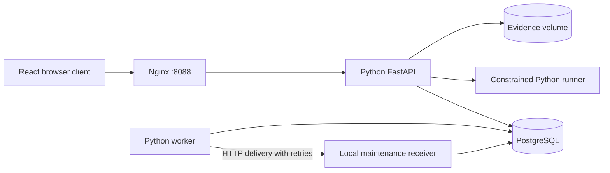

# Architecture

Only the web container is exposed to the host, on `127.0.0.1`. Nginx forwards `/api/`, `/restserver/` and `/ssf/` to the API. The `/internal/maintenance` route is reachable only within the container network and requires the worker token. Database and worker have no published ports.

## Inspection transaction

Creation selects the building-specific binding if present, otherwise the newest global configuration; it pins that version and executes initial state entry effects. Sensor-generated records use the same initial hierarchy and computed values. Edits in workflow-permitted states lock the record, compare its revision, validate each value's type and option membership, update the values and append an audit event in the same transaction.

Transitions lock the record and compare its revision, locate the selected transition in that record's pinned configuration, verify source state and role, and apply configured comment requirements. Submission additionally enforces required fields and photographic evidence for exceptions. An exception creates a corrective task and integration job transactionally. Closure requires no open tasks. All transitions append actor, timestamp, source, target and comment.

## Configuration

A configuration contains 1–40 fields, 2–20 unique states and 1–80 transitions. Draft and Closed are the initial and final states; intermediate states and directed edges are editable. Every state must be reachable from Draft and able to reach Closed. Metadata records state editability and canvas coordinates. Published versions remain immutable, with optimistic concurrency on publication.

Seven field types are supported: number, text, choice, checkbox, date, datetime and email. Fields support sections, ordering, one/two-column preview width, defaults, help text, required values, numeric operating limits and role-based edit permissions. Structured Invalid If, Raise Flag If and Visible If rules use typed equality, numeric comparisons, text containment and empty/non-empty checks. No expressions are evaluated as executable code. Invalid/flag rules match any condition; visibility and transition guards require all conditions.

`check_transition` is the shared server implementation for live records and `/api/workflow/simulate`. It verifies the source, role, comments, field guards, required-input validation, evidence and outstanding tasks. Live execution also creates configured exception tasks and writes the transition audit. Simulation accepts explicit evidence/task counts and never writes records or jobs.

A working copy is retained in browser storage and reused only when its base published version matches the server. Import/export uses the independent `campus-demo/v1` JSON schema; publication and import both run server validation. The runtime does not execute native J5 packages or integrate with external identity directories. Local spreadsheet formulas and hierarchical workflows are implemented independently, as described below.

## Operational logbook

`log_entries` stores equipment, category, event time, message, status, priority, author, closure metadata and handover inclusion. `log_notes` stores append-only notes/flags; `log_history` stores before/after edits and note events. Entry edits take a row lock and compare revisions. Technicians cannot close entries or revise already closed entries. All authenticated users can add notes, including to closed entries.

The API filters/sorts and paginates logbook records in SQL; the browser provides list/timeline/calendar views and a column picker. CSV exports the entire filtered result, with spreadsheet formula prefixes escaped. List views poll; editing views are not overwritten by polling. New handover snapshots include non-closed entries marked for handover. Existing snapshots remain unchanged. The logbook is separate from inspection records and has its own audit history.

## Worker

The database-backed queue needs no Redis. A worker claims a ready job with a row lock held through processing. Process termination releases the transaction and leaves the job ready for another attempt. Sensor processing and new record/task creation commit together. External HTTP calls cannot be atomically committed with a database transaction, so the receiver uses a stable task ID as an idempotency key.

For demonstration, each new maintenance job's first HTTP delivery returns 503; later delivery succeeds. Retries wait 4, 8, 16 and 32 seconds, then become terminal on the fifth failure. The worker checks overdue open tasks and records an escalation once. A separate heartbeat transaction makes worker liveness visible even while the queue is empty.

## Evidence and persistence

Images are stored under generated UUIDs, not user-controlled filenames. Uploads validate PNG/JPEG/WebP content and record a hash, byte count and original filename. The evidence volume and PostgreSQL volume outlive container restarts. If a database write fails during upload, its newly written file is removed.

Database transactions and audit entries are application controls for the demo. This implementation is not a certified safety system, a tamper-evident ledger or a complete J5 authorization framework.

## Spreadsheet and formula runtime

A definition may include a 500-row × 52-column sheet with scalar cells, field bindings, formulas, merged ranges and allowlisted formatting. `formulas.py` tokenizes expressions into a bounded AST; it never uses Python eval/exec. It enforces token, nesting, range, dependency-depth and evaluation budgets. Field references, cell references and bound cells participate in cycle detection, including cells inside ranges. Formula outputs are recalculated by the API rather than trusted from browser values. `/api/forms/calculate` supplies preview/runtime results and per-cell errors; `/api/formulas` exposes the supported function catalog. Incomplete draft calculations can remain unresolved at creation; save and workflow actions require successful calculations.

## Hierarchical workflow semantics

`state_tree` extends the top-level status list with up to 100 nodes and six nesting levels. Compound nodes enter one initial child; parallel nodes enter 2–6 compound regions. Atomic/final leaves are persisted in `records.active_states`. Parent actions are available to active descendants. Completion transitions execute automatically after every parallel region completes, with a 30-step loop limit. Exit, transition and entry effects assign scalar form values through the formula interpreter. Final nodes are read-only.

Live actions and simulation share `advance` and `check_transition`. A live action and its automatic completion chain commit atomically, or all roll back on a failed guard. Newly planned exception tasks count against closure guards within the same chain. Automatic transitions do not require a second button click or re-check the triggering person's role; their validation/comment/evidence/task/formula guards still apply. This is an explicit local semantic choice, not a claim of complete J5/SCXML equivalence. Durable entry-relative deadlines are stored in `workflow_timers`; the worker executes due actions transactionally. Failed guards leave visible Blocked timers; supervisors may retry. Departure cancels pending timers and re-entry schedules a fresh deadline. Shallow/deep history is persisted in `workflow_history`. Deferred-event queues and cross-region jumps are unsupported.

## Developer projects and controlled releases

`dev_projects` holds split form/workflow JSON plus editable text examples, with optimistic revisions. Saving requires a valid project. The independent `campus-project/v2` ZIP contains SHA-256 checksums. Import bounds archive sizes and rejects traversal, duplicates, symlinks, encryption and mismatched hashes; it reads content without extracting or executing it. Unknown archives are inventoried only. Selected Python source can run in a separate non-root container with an internal-only network, read-only root, temporary filesystem, CPU/memory/process/output limits and a five-second timeout. Trace mode records up to 200 line events and scalar locals. It executes the selected file, not a complete multi-file project or native J5 SDK. This is for trusted local administrators, not a security-certified multitenant sandbox.

`config_items` follows Draft → In Review → Approved → Published, with return to Draft on rejection. The submitter cannot approve their own item; review requires a comment. Item edits retain definition snapshots in `config_item_history`. Publication locks the global configuration version and rejects a stale base. Building-scoped releases create an immutable version and update `config_bindings`, leaving the global default unchanged. Direct publication is rejected while `REQUIRE_REVIEW=true` (the default). Explicit development mode can opt out.

## Rich text and logbook attachments

The API stores sanitized HTML plus derived plain text for search/export. Formatting uses a small allowlist; scripts, event handlers, embedded images, styles and unsafe links are removed. Attachments accept verified PNG/JPEG/WebP images, PDF signatures, or UTF-8 TXT/CSV, up to 10 MB each and 20 active files per entry. Upload/removal checks the entry revision and closed-entry permissions. Downloads require authentication and use attachment disposition. Soft deletion retains metadata/files and audit history while removing normal download access. This demo does not include antivirus scanning or file-retention administration.

## Local API compatibility surface

`/restserver/30/industraform/logbook-query[-v2]/campus_inspections` follows the documented query path and response envelope over local inspection data. It supports selected attributes and explicitly named local filter extensions. Undefined elements follow the documented null/IsDefined=false semantics; unknown parameters or attribute suffixes fail. `/api/native-contract` identifies the reference and unverified compatibility boundary; `/api/openapi.json` documents the actual local API. No external J5 installation is contacted.

## Reusable resources and building access

Definitions support up to ten repeating tables, 500 rows per table and 30 columns. Table/field IDs are globally unique for unambiguous query attributes. Row formulas, required inputs and role restrictions are enforced by the API. Named option lists and themes resolve inheritance with cycle/depth limits. Equipment lookup lists can capture a snapshot of the register. XLSX interchange preserves layout, formulas, bindings and local project metadata; macros and external links are rejected. It does not execute native IndustraForm definitions.

Building grants are loaded on every authenticated request, including Basic authentication. Records, uploads/downloads, tasks, sensor input, native-shaped queries, logbooks, handovers and scoped configuration versions are checked. Administrators retain campus-wide access. Legacy handovers without a scope are hidden from restricted users because their narrative may contain campus-wide information. SSO and offline synchronisation are not implemented.

See [API-CONTRACT.md](API-CONTRACT.md) for the expanded native-shaped surface and its explicit interpretations.
